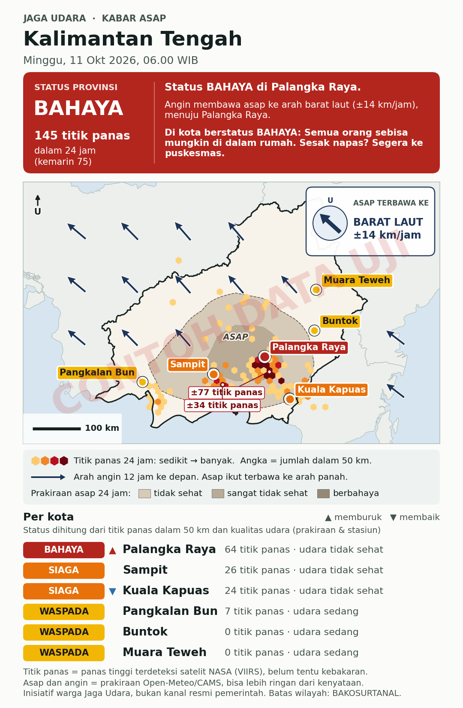

# Bot Peringatan Asap Jaga Udara

Bot otomatis yang memantau titik panas (hotspot) dan asap di Kalimantan dan Sumatera, lalu mengirim kabar berbahasa sederhana ke kanal Telegram per provinsi. Setiap kirim, bot juga membuat gambar kartu dan teks siap salin untuk Saluran WhatsApp.

Inisiatif warga, bukan kanal resmi pemerintah. Biaya: Rp 0.



## Apa yang dikerjakan bot

Setiap 3 jam mulai 06.00 WIB (06.00, 09.00, 12.00, 15.00, 18.00, 21.00, 00.00, 03.00) bot berikut dijalankan. Pemicunya **cron-job.org** supaya tepat waktu, dengan jadwal GitHub sebagai cadangan; cara memasangnya ada di [docs/PANDUAN-CRON-JOB.md](docs/PANDUAN-CRON-JOB.md). Kalau dua pemicu jalan untuk slot yang sama, pesan hanya dikirim sekali.

Yang dikerjakan bot:

1. **Mengambil data**
   - Titik panas 3 hari terakhir dari satelit VIIRS (NASA FIRMS)
   - Prakiraan PM2.5 per jam untuk tiap kota (Open-Meteo, model CAMS)
   - Untuk peta: prakiraan PM2.5 di grid 0,5° dan angin 10 m di grid 1° (Open-Meteo, satu permintaan per grid)
   - Angka stasiun pemantau terdekat (WAQI), kalau token diisi
2. **Menentukan status tiap kota**: AMAN, WASPADA, SIAGA, atau BAHAYA (aturannya di bawah)
3. **Mengirim**
   - Pukul 06.00, 09.00, 12.00, 15.00, 18.00, dan 21.00 WIB: ringkasan (gambar kartu + pesan + PDF panduan) ke kanal Telegram
   - Pukul 00.00 dan 03.00 WIB: hanya mengirim peringatan (+ PDF) kalau ada kota yang naik ke SIAGA atau BAHAYA, supaya warga tidak terbangun tiap 3 jam
4. **Menyimpan** gambar, teks Telegram, dan teks WhatsApp di folder `arsip/`, serta status terakhir di `state/status.json`

### Isi kartu gambar

- **Pita status** di atas: status provinsi, kota terburuk, ke mana asap terbawa angin (dan kota yang dituju kalau ada), lalu yang perlu dilakukan.
- **Peta**:
  - kepadatan titik panas (heksagon kuning → merah tua), bukan ribuan titik, supaya tidak terkesan lebih tepat dari datanya
  - label "±N titik panas" di pusat terpadat (jumlah dalam radius yang sama dengan daftar kota)
  - bayangan coklat-abu "ASAP" = prakiraan udara tidak sehat ke atas (rata-rata 24 jam)
  - panah angin 12 jam ke depan, menunjuk ke arah asap terbawa
  - kota berwarna sesuai status, skala 100 km, tanda utara
  - kotak "ASAP TERBAWA KE"
- **Daftar kota** dengan ▲/▼ dibanding kabar sebelumnya.
- **Warna status**: biru (AMAN), kuning (WASPADA), oranye (SIAGA), merah tua (BAHAYA). Hijau sengaja tidak dipakai supaya tetap bisa dibedakan oleh penderita buta warna. Status juga selalu ditulis dengan kata.
- **Kalau data angin atau asap gagal diambil**, kartu tetap dibuat dan menulis "data belum tersedia". Kota tanpa data kualitas udara ditandai abu-abu "DATA KURANG", bukan "AMAN".

Contoh pesan: [harian](docs/contoh/pesan-harian-whatsapp.txt), [peringatan](docs/contoh/pesan-peringatan-whatsapp.txt). Semua contoh di folder `docs/contoh/` memakai **data uji buatan**, bukan data asli.

## Cara status ditentukan

Status kota = tingkat **tertinggi** dari tiga penilaian berikut.

| Penilaian | AMAN | WASPADA | SIAGA | BAHAYA |
|---|---|---|---|---|
| Prakiraan PM2.5 rata-rata 24 jam ke depan (kategori ISPU) | Baik | Sedang | Tidak Sehat | Sangat Tidak Sehat / Berbahaya |
| Titik panas dalam 50 km, 24 jam terakhir | 0–9 | 10–49 | 50–199 | 200 ke atas |
| Stasiun terdekat ≤30 km, data ≤6 jam (AQI skala AS) | 0–100 | 101–150 | 151–200 | 201 ke atas |

- Batas ISPU mengikuti Permen LHK No. 14/2020.
- **Ambang titik panas adalah ambang awal** dan perlu disesuaikan setelah beberapa minggu dipakai. Ubah di `bot/analisis.py` (`AMBANG_TITIK_API`).
- Titik panas berkeyakinan rendah dibuang. Deteksi dari beberapa satelit di sel ±1 km yang sama dihitung satu.

## Memasang (sekali saja, sekitar 30 menit)

### 1. Repo GitHub
Buat repo baru (Public, supaya GitHub Actions gratis), lalu unggah seluruh isi folder ini.

File jadwal harus ada tepat di `.github/workflows/peringatan-asap.yml` di akar repo (bukan di dalam folder `jaga-udara-bot/`). Nama folder tidak boleh mengandung spasi: `.github` dan `workflows`, bukan `.github ` atau ` workflows `. Kalau ada spasi, tab Actions tetap menampilkan "Get started".

### 2. Kunci data NASA FIRMS (gratis)
Buka https://firms.modaps.eosdis.nasa.gov/api/map_key/ , masukkan email, lalu salin MAP_KEY yang dikirim.

### 3. Bot dan kanal Telegram
1. Di Telegram, buka **@BotFather**, kirim `/newbot`, beri nama (misalnya "Jaga Udara Bot"), lalu salin **token**-nya.
2. Buat **kanal** baru (New Channel), misalnya `Jaga Udara – Kalteng`, jenis Public, dengan alamat misalnya `@jagaudara_kalteng`.
3. Tambahkan bot sebagai **admin** kanal itu, dengan izin "Post messages" dan "Edit messages of others" (perlu untuk menyematkan PDF panduan).

### 4. Simpan rahasia di GitHub
Buka repo, lalu **Settings > Secrets and variables > Actions > New repository secret**:

| Nama | Isi |
|---|---|
| `FIRMS_MAP_KEY` | kunci dari langkah 2 |
| `TELEGRAM_BOT_TOKEN` | token dari @BotFather |
| `TELEGRAM_CHAT_KALTENG` | alamat kanal, misalnya `@jagaudara_kalteng` |
| `TELEGRAM_CHAT_KALBAR`, `TELEGRAM_CHAT_KALSEL`, `TELEGRAM_CHAT_KALTIM`, `TELEGRAM_CHAT_KALTARA` | alamat kanal provinsi lain, dengan bot sebagai admin |
| `WAQI_TOKEN` | opsional, token WAQI |

### 5. Coba jalankan
Buka tab **Actions > Peringatan asap > Run workflow**:
- isi `provinsi` (mis. `kalbar,kalsel`) untuk menjalankan provinsi tertentu saja; kosongkan untuk semua
- isi `coba` = `ya` untuk uji tanpa mengirim (hasilnya ada di folder `jaga-udara-bot/arsip/`)
- isi `mode` = `harian` untuk langsung mengirim ringkasan ke kanal

Setelah itu bot berjalan sendiri sesuai jadwal.

## PDF panduan bergambar

Bot mengirim `docs/panduan-asap-keluarga.pdf` tepat setelah setiap pesan. PDF juga disematkan (pin) di bagian atas kanal, tapi hanya sekali, dan disematkan ulang kalau isinya berubah.

Saluran WhatsApp tidak bisa memuat file PDF, jadi teks untuk WhatsApp tidak menyebut panduan. Bagikan PDF-nya langsung ke grup WhatsApp kalau perlu.

Untuk mengubah isi panduan: edit `docs/panduan/panduan-asap-keluarga.html`, lalu buat ulang PDF-nya dari folder `docs/panduan` dengan `node buat-pdf.js` (perlu Node.js dan `npm i playwright`).

## Menambah provinsi

Di `config/provinsi.json`, ubah `"aktif": false` menjadi `true` untuk provinsi yang diinginkan (Kalbar, Kalsel, Riau, Jambi, Sumsel sudah disiapkan), lalu buat kanal dan secret `TELEGRAM_CHAT_...` yang sesuai. Kota bisa ditambah dengan nama dan koordinatnya.

## Menjalankan di komputer sendiri

```bash
pip install -r requirements.txt
python tests/buat_fixture.py                  # buat data uji
FIXTURES=tests/fixtures WAKTU_UJI=2026-10-10T23:00:00+00:00 python -m bot.main --coba --provinsi kalteng
python -m unittest discover tests             # uji dasar
```

Dengan data asli: isi variabel `FIRMS_MAP_KEY` (dan lainnya), lalu `python -m bot.main --coba`.

## Batasan yang perlu diketahui

- **Satelit:** satelit VIIRS lewat beberapa kali sehari dengan jeda data sekitar 3 jam. Titik panas bisa terlewat kalau tertutup awan atau asap tebal, dan satu titik panas belum tentu kebakaran.
- **Prakiraan:** model CAMS beresolusi sekitar 45 km dan bisa jauh lebih rendah dari kenyataan saat kebakaran gambut. Pakai untuk melihat tren.
- **Hitungan per kota:** titik panas di sekitar kota dihitung dalam lingkaran 50 km, termasuk yang berada di provinsi tetangga.
- **Batas Open-Meteo gratis:** kurang dari 10.000 panggilan/hari, dan permintaan banyak lokasi dihitung per lokasi. Kalau ditolak (HTTP 429), peta dibuat tanpa lapisan angin/asap, dan pesan tetap terkirim.
- **Jadwal GitHub:** bisa terlambat 5–30 menit, kadang lebih, dan sesekali terlewat. Setiap kali bot jalan, jam mulainya dicatat di `state/log-jadwal.csv` (slot jadwal, jam mulai sebenarnya, berapa menit terlambat, jumlah pesan terkirim). Pakai log itu untuk menentukan rentang jam yang diumumkan ke warga. Bot menyimpan arsip setiap putaran supaya repo tetap aktif, karena jadwal otomatis berhenti kalau repo 60 hari tanpa perubahan.
- **Tanpa pengujian lapangan:** bot belum diuji dengan data asli karena dibuat di lingkungan tanpa akses ke NASA dan Open-Meteo. Lakukan langkah 5 dengan `coba = ya` dulu.

## Sumber data dan lisensi

- Titik panas: NASA FIRMS (VIIRS 375 m NRT)
- Prakiraan asap: Open-Meteo Air Quality API (CC BY 4.0), berbasis Copernicus Atmosphere Monitoring Service
- Angin: Open-Meteo Forecast API (CC BY 4.0)
- Stasiun: World Air Quality Index Project dan badan pemantau asal, termasuk BMKG. Wajib dicantumkan; tidak boleh dijual.
- Batas provinsi: Peta Dasar BAKOSURTANAL 1:250.000, via github.com/ans-4175/peta-indonesia-geojson. Cek lisensinya sebelum dipakai lebih luas.
- Kategori ISPU: Permen LHK No. 14/2020
